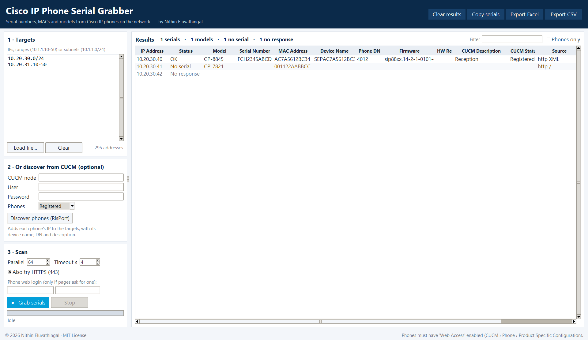

# Cisco IP Phone Serial Grabber

*by Nithin Eluvathingal — MIT Licensed*

Cisco IP Phone Serial Grabber reads the **serial number, MAC address, model, device name, directory number and
firmware** from every Cisco IP phone it can reach on your network, then exports the list to Excel or CSV. Use it for
asset audits, Smart Account and contract checks, RMA paperwork, or a quick count of phones by model.

You can give it IP addresses, ranges and subnets, or let it ask **CUCM** which phones are registered and where they are.



## Run it

1. Install **Python 3.9 or newer** (Tkinter is included).
2. Install the two libraries it needs:
   ```bash
   py -m pip install requests openpyxl
   ```
3. Double-click `run_app.bat`, or run `py grabber_app.py`.

## Before you start: enable Web Access on the phones

The tool reads each phone's own web page, so **Web Access must be enabled** on the phones:

- CUCM › **Device › Phone** › open the phone › **Product Specific Configuration Layout** › **Web Access = Enabled**.
- To change many phones at once, set it in a **Common Phone Profile** or with **Bulk Administration**, then apply the config.

Phones with Web Access off show up as **Web closed** or **No response**. After a CUCM lookup, the tool also tells you
how many phones report their web server as disabled.

## Using the app

### 1 · Targets

Type or paste the addresses to check. You can mix these, one per line or separated by commas or spaces:

| You type | It scans |
|---|---|
| `10.1.1.25` | one phone |
| `10.1.1.10-50` | 10.1.1.10 to 10.1.1.50 |
| `10.1.1.10-10.1.2.20` | a range across subnets |
| `10.1.1.0/24` | every host in the subnet |
| `sep-lobby.example.local` | a host name |

Lines starting with `#` are ignored. **Load file…** reads IPs, ranges and subnets from a `.txt`, `.csv` or `.xlsx`
file and ignores everything else in it. The counter under the box shows how many addresses will be scanned
(the limit is 65,536, i.e. a /16).

### 2 · Discover from CUCM (optional)

Enter a CUCM node, a user and a password, choose **Registered** or **Any**, and click **Discover phones (RisPort)**.
The tool asks the CUCM Real-Time Information service (RisPort70) for every phone and adds each phone's IP to the
target list. It also keeps the CUCM device name, DN, description and registration status, and shows them in the
results.

Newer CUCM releases refuse the `*` wildcard (*"SelectItems cannot contain \*"*). When that happens the tool reads
the phone names over **AXL** and asks RisPort for them 1,000 at a time, so the CUCM user then also needs AXL access.

| CUCM user role | Needed for |
|---|---|
| Standard CCM Admin Users | logging in to the APIs |
| Standard Serviceability Read Only (or Standard RealtimeAndTraceCollection) | RisPort phone lookup |
| Standard AXL API Access | the fallback on CUCM versions that refuse `*` |

### 3 · Scan

- **Parallel** — how many phones to query at once (default 64).
- **Timeout s** — how long to wait for each phone (default 4 seconds).
- **Also try HTTPS (443)** — for phones that only serve their web pages over HTTPS. Self-signed certificates are accepted.
- **Phone web login** — only needed if the phones' pages ask for a username and password (for example some
  Multiplatform phones).

Click **▶ Grab serials**. **Stop** ends the scan after the requests already running finish.

### Results

Each address gets a status:

| Status | Meaning |
|---|---|
| **OK** | serial number read |
| **No serial** | the phone answered but did not report a serial number |
| **Web closed** | port open, but the web page could not be read |
| **Not a phone** | a web server answered, but it is not a Cisco phone page (printer, PC, switch…) |
| **No response** | nothing on TCP 80/443, or the host is down |
| **Error** | something unexpected; see the Note column |

- **Filter** searches every column. **Phones only** hides addresses that are not phones.
- Click a column heading to sort.
- Right-click rows to copy them, copy the serial or MAC, open the phone's web page, or **re-scan** just those phones.
- **Copy serials** puts serial, model, MAC and IP (tab separated) on the clipboard, ready to paste into Excel.
- **Export Excel** writes a **Phones** sheet (filterable, with the header row frozen) and a **Summary** sheet with
  phone counts by model and by status. **Export CSV** writes the same columns as plain text. Exports include only
  the rows that are currently shown, so you can filter first.

## Supported phones

Anything that serves Cisco's device information pages, including:

- **7800, 8800, 8900, 9900, 6900, DX** series and Cisco conference phones, through the XML page `/DeviceInformationX`.
- **Older 7900** series, through the HTML pages `/DeviceInformation` and
  `/CGI/Java/Serviceability?adapter=device.statistics.device`.
- **Multiplatform (3PCC / MPP)** phones, through the **Info** page at `/` (as long as it does not require a login,
  or you enter the login).

If the serial is not reported directly, the tool takes it from the phone's UDI. A missing MAC is worked out from the
`SEP…` device name.

## Command line

`grabber_engine.py` also works on its own, for scripts and scheduled jobs:

```bash
py grabber_engine.py 10.10.20.0/24 10.10.21.5-80 -o phones.xlsx
```

```bash
py grabber_engine.py --cucm 10.10.1.10 --user axluser -o phones.xlsx
```

| Option | Meaning |
|---|---|
| `targets` | IPs, ranges, subnets (as in the app) |
| `-f FILE` | read targets from a `.txt`, `.csv` or `.xlsx` file |
| `--cucm HOST --user USER` | discover phones from CUCM; the password is asked for if `--password` is not given |
| `--any-status` | include unregistered phones from CUCM |
| `--phone-user`, `--phone-password` | phone web login, if needed |
| `-w N` | parallel queries (default 64) |
| `-t SECONDS` | timeout per phone (default 4) |
| `--no-https` | do not try HTTPS |
| `-o FILE` | save to `.xlsx` or `.csv`; without it the phones are printed as a table |

## Privacy

- Passwords are never saved.
- The app remembers your last target list, CUCM node, CUCM user and scan options in
  `%APPDATA%\CiscoIPPhoneSerialGrabber\settings.json`. Delete that folder to clear them.
- Scan results are kept only in the window until you export them.

## Files

| File | What it is |
|---|---|
| `grabber_app.py` | the Tkinter app |
| `grabber_engine.py` | target parsing, phone queries, CUCM RisPort/AXL discovery, Excel/CSV export, command line |
| `run_app.bat` | starts the app without a console window |

## Licence

MIT — see [LICENSE](LICENSE).
